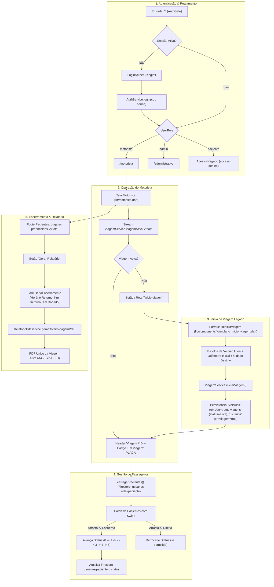

# Relatório da Fase 0 – Levantamento e Análise de Arquitetura (Issue #65)

**Data**: 07/11/2026  
**Repositório**: `BrunoCamiloRibeiro/InterFatec2`  
**Branch de Trabalho**: `65-correção-de-bugs` (commit base `e353b13`)

---

## 1. Levantamento de Pull Requests e Branches Ativas

Foi inspecionado o estado completo do repositório remoto via API do GitHub e comandos git.

### Pull Requests Abertos
1. **PR #64**: `feat(pessoas): implementar CRUD completo de pessoas com filtros, busca e soft delete (#34)`
   - **Branch**: `feat/34-crud-de-pessoas` -> base `develop`
   - **O que muda**: Adiciona regras de segurança no Firestore (`firestore.rules`, `firestore.indexes.json`), serviço administrativo de pessoas (`pessoa_service.dart`) e formulário de cadastro de pessoas (`formulario_pessoa.dart`).
   - **Impacto na #65**: Nulo. Trata do painel de administração e cadastro de novos cidadãos. Não afeta a declaração de veículo nem o fluxo de viagens e passageiros do motorista.
2. **PR #63**: `feat(veiculos): implementar gestao de veiculos com crud, filtros modais e status interativo`
   - **Branch**: `ID03---33-crud-de-veiculos` -> base `develop`
   - **O que muda**: Implementa CRUD administrativo de veículos (`card_veiculo.dart`, `formulario_novo_veiculo.dart`, `veiculo_controller.dart`).
   - **Impacto na #65**: Nulo. Trata de cadastro administrativo de veículos. O motorista consome os veículos existentes na coleção `veiculos`.

### Branches Ativas Relevantes
- **`17-formulário-de-viagem`**: Branch do PR #51 que originalmente criou o formulário de início de viagem. Seus commits já foram 100% integrados em `develop` e estão presentes no HEAD da branch `65-correção-de-bugs`.
- **`65-correção-de-bugs`**: Branch oficial de trabalho desta tarefa, sincronizada com o commit `e353b13` da `develop`. Contém as features de autenticação (`auth_gate.dart`, `login_screen.dart`, `auth_service.dart`), tela do motorista (`motorista.dart`), cabeçalho com paginação (`motorista_header.dart`) e gerador do PDF oficial (`relatorio_pdf_service.dart`).

> [!NOTE]
> Nenhuma alteração das branches externas (PR #63 ou #64) precisa ser incorporada à branch #65, mantendo o escopo estritamente focado e livre de regressões externas.

---

## 2. Mapeamento do Fluxo Atual de Ponta a Ponta

### Arquivos, Rotas e Modelos Envolvidos
- **Rotas**: `/`, `/login`, `/motorista`, `/inicio-viagem`, `/paciente`, `/administrativo`.
- **Arquivos**:
  - `lib/screens/auth_gate.dart`, `lib/screens/login_screen.dart`, `lib/routes/route_guard.dart`.
  - `lib/motorista.dart`, `lib/components/motorista_header.dart`, `lib/components/card_paciente.dart`, `lib/components/footer_pacientes.dart`.
  - `lib/components/formulario_inicio_viagem.dart`, `lib/components/formulario_encerramento.dart`.
  - `lib/services/viagem_service.dart`, `lib/services/relatorio_pdf_service.dart`, `lib/services/auth_service.dart`.
  - `lib/models/viagem_model.dart`, `lib/models/paciente_model.dart`, `lib/models/veiculo_model.dart`, `lib/models/user_role.dart`.
- **Coleções do Firestore**: `usuarios`, `veiculos`, `viagens`.

---

## 3. Schema Real do Banco e Levantamento da Base de Amostra

### Schema de Dados
- **Coleção `usuarios`**:
  - Documentos polimórficos identificados pelo UID do Firebase Auth (ou docId).
  - Campos do Paciente (`PacienteModel`): `id`, `nome`, `cpf`, `telefone`, `enderecoPaciente`, `localConsulta`, `localSaida`, `horarioConsulta`, `status` (0 a 5), `nomeAcompanhante`, `telAcompanhante`, `role` ('paciente'), `ativo` (bool), `criadoEm` (DateTime).
  - Campos do Motorista (`MotoristaModel`): `id`, `nome`, `cpf`, `telefone`, `email`, `cnh`, `veiculoModelo`, `veiculoPlaca`, `capacidadeVeiculo`, `role`, `emViagem`.
  - Campos do Administrador (`AdminModel`): `id`, `nome`, `cpf`, `email`, `telefone`, `role`, `ativo`.
- **Coleção `veiculos`**: `id`, `placa`, `modelo`, `capacidade`, `quilometragemAtual`, `emUso`, `motoristaAtualId`.
- **Coleção `viagens`**: `id`, `motoristaId`, `motoristaNome`, `veiculoId`, `veiculoPlaca`, `veiculoModelo`, `kmInicial`, `cidadeDestino`, `dataHoraInicio`, `status` ('ativa' / 'encerrada'), `kmFinal`, `kmRodado`, `dataHoraFim`, `observacoes`, `passageirosIds`.

### Levantamento Estatístico da Base de Amostra
Analisando `assets/data/dados_pacientes.json` (5 pacientes catalogados):
- **Pacientes com CPF preenchido**: 0 de 5 (0%)
- **Pacientes só com acompanhante**: 0 de 5 (0%)
- **Pacientes só com RG/CNH**: 0 de 5 (0%)
- **Pacientes sem nenhum documento**: 5 de 5 (100%)
- **CPFs duplicados**: 0

Nos mocks em código (`lib/lista_pessoas.dart` e `lib/motorista.dart`):
- Todos os registros mockados possuem CPF formatado (`000.000.000-00`).
- Existe reutilização do mesmo CPF de teste (`123.456.789-00`) entre os mocks de `motorista.dart`, `paciente.dart` e `lista_pessoas.dart`.

---

## 4. Registro de Layout do PDF Atual como Referência

O documento oficial "Roteiro da Viagem - Ficha de Atendimento TFD" segue as medidas do arquivo `CamScanner_11-10-2026_21_52.pdf`:
- **Formato**: A4 retrato (210 x 297 mm / 595.28 x 841.89 pt).
- **Margens**: Esquerda 42 pt, Direita 42 pt, Superior 15.6 pt, Inferior 30 pt.
- **Cabeçalho**: Unidade Básica de Saúde de Poloni, dados da viagem (Motorista, Veículo, Saída, Requisição, Destino Principal).
- **Linha 1 do Paciente**: Nome (largura 227 pt, negrito 7.5 pt), Telefone (79 pt), Acompanhantes (expandido), Tel. Acompanhante (78 pt).
- **Linha 2 do Paciente**: Endereço (195 pt), Local de Saída (123 pt), Destino (expandido), Horário Consulta (55 pt).
- **Pitch entre pacientes**: 50.7 pt fixos.
- **Capacidade**: Máximo 11 pacientes na Página 1; o resumo avança para a Página 2 caso haja mais de 9 pacientes.
- **Bloco de Resumo**: Total de Pacientes, Total de Acompanhantes, Total Geral, Retorno, Km Saída, Km Retorno, Km Rodado e Assinatura do Motorista.

---

## 5. Testes de Caracterização da Fase 0

Foi implementada a suíte `test/caracterizacao_fluxo_atual_test.dart` com **12 testes automatizados** cobrindo:
1. `ViagemService`:
   - Lista inicial de veículos livres (`XYZ-9K88` ocupado é filtrado).
   - Validação de odômetro impedindo recuo de quilometragem.
   - Validação de odômetro impedindo salto abusivo (> 2000 km).
   - Início de viagem com persistência de dados e emissão reativa em stream.
   - Encerramento de viagem liberando a referência ativa.
2. `PacienteModel`:
   - Cálculo de assentos: status 1/3 sem acompanhante = 1 assento; com acompanhante = 2 assentos.
   - Status 0 (aguardando) ou 4/5 (concluído/cancelado) = 0 assentos a bordo.
   - Mapeamento exato de rótulos e cores para todos os status (0 a 5).
3. `RouteGuard` & `AuthService`:
   - Liberação de `/motorista` para perfil motorista.
   - Bloqueio de acesso cruzado para perfil paciente, redirecionando para a tela do paciente.
4. `RelatorioPdfService`:
   - Geração de PDF com layout oficial A4 e validação de tamanho de bytes.

> [!IMPORTANT]
> Todos os **109 testes** do projeto (97 testes preexistentes + 12 testes de caracterização) foram executados e passaram com **100% de sucesso**.

---

## 6. Decisões Arquiteturais Conservadoras para a Fase 1

1. **Sessão de Veículo do Motorista -> N Viagens Ativas**:
   - `FormularioInicioViagem` passa a se comportar como **Declaração de Veículo**: seleciona o veículo e quilometragem inicial (se ainda não declarada).
   - Cria o modelo `SessaoVeiculoModel` (`id`, `motoristaId`, `motoristaNome`, `veiculoId`, `veiculoPlaca`, `veiculoModelo`, `kmInicial`, `dataHoraInicio`, `status`).
   - A sessão mantém uma lista de viagens ativas associadas (`viagens: List<ViagemModel>`).
   - Na tela do motorista, o `MotoristaHeader` já suporta `onAnterior` e `onProxima`: agora ele navega entre as viagens ativas da sessão.
   - Plano de reversão de migração: viagens sem `sessaoId` são encapsuladas dinamicamente com base em seu `veiculoId` e `motoristaId`.

2. **PDF em Lote Atômico e Idempotente**:
   - `RelatorioPdfService.gerarLoteViagensPdf(List<ViagemModel> viagens, Map<String, List<PacienteModel>> pacientesPorViagem)`.
   - Considera apenas pacientes com baixa (status >= 1) de cada viagem.
   - Falha atômica: se a compilação de qualquer uma das viagens falhar, a operação lança exceção com o ID da viagem causadora sem retornar lote corrompido.

3. **Código de Acesso Criptograficamente Seguro e Hash**:
   - Gerado no momento do embarque (transição para status 1).
   - Formato: 4 a 5 dígitos puramente numéricos (1000 a 99999), gerados via `Random.secure()`.
   - Único por viagem: verificação de colisão antes da emissão.
   - Acompanhante: compartilha o mesmo código do paciente titular.
   - Idempotência: tocar em "embarcou" novamente preserva o código já gerado.
   - Expiração: código invalidado ao encerrar a viagem.
   - Hash vs Exibição: O código em texto claro é mantido restrito na sessão do motorista apenas durante a viagem ativa (permitindo exibição no card do paciente). O login do paciente valida contra o hash seguro (SHA-256 + salt da viagem). Ao término da viagem, o código claro é purgado.

4. **Login do Paciente (CPF + Código de Acesso)**:
   - Ordem de resolução: (a) CPF do paciente -> (b) CPF do acompanhante -> (c) Outro documento -> (d) Ignorado com log interno seguro.
   - Validação com algoritmo oficial do CPF (módulo 11) e normalização (dígitos).
   - Rate limiting: bloqueio por 15 minutos após 5 tentativas incorretas por CPF/IP.
   - Mensagem genérica contra enumeração de usuários ("Credenciais inválidas ou viagem não localizada").
