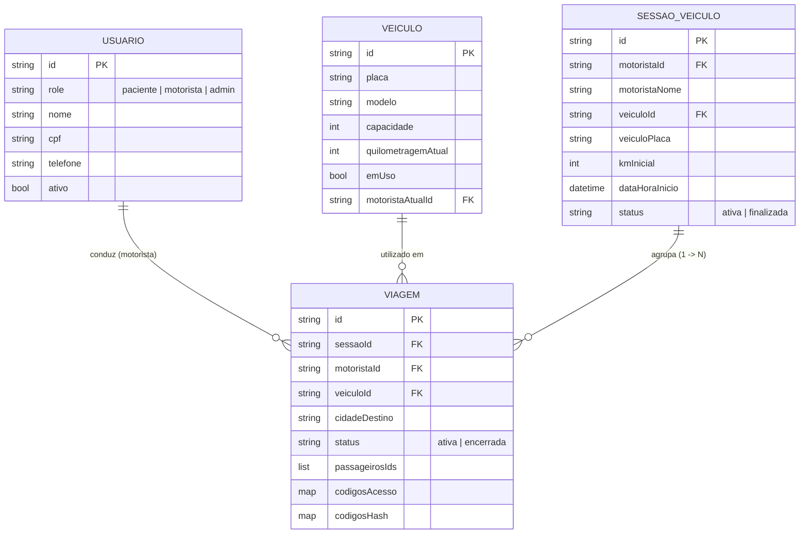
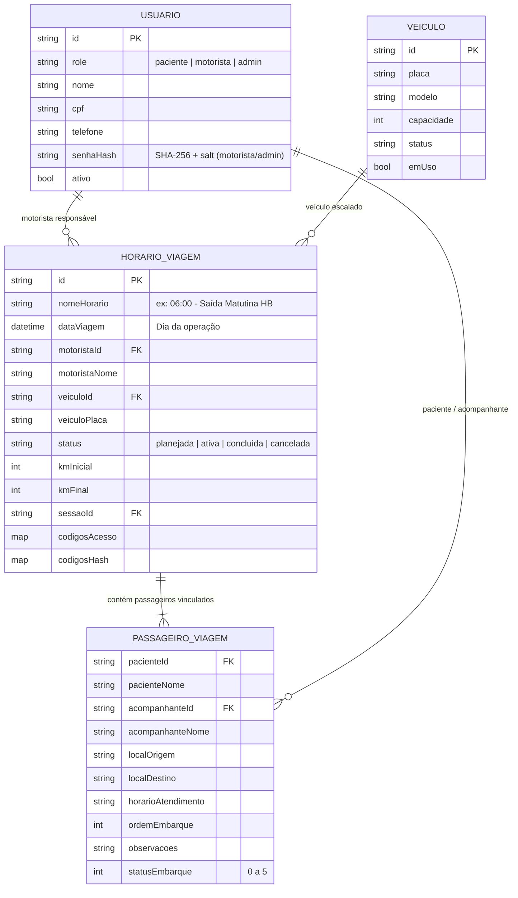

# Relatório da Fase 0 – Levantamento, Arquitetura e Diagnóstico de Login (Issue #65)

**Data**: 07 de Novembro de 2026  
**Repositório**: `BrunoCamiloRibeiro/InterFatec2`  
**Branch de Trabalho**: `65-correção-de-bugs`  
**Status**: Fase 0 Concluída com Caracterização e Reprodução Comprovadas  

---

## 1. Análise Comparativa dos CRUDs Existentes (Pessoas vs Veículos)

Foi realizada a leitura integral do código do **CRUD de Pessoas** (desenvolvido pelo João na branch `feat/34-crud-de-pessoas`, PR #64) e do **CRUD de Veículos** (desenvolvido pela Audrey na branch `ID03---33-crud-de-veiculos`, PR #63).

### Matriz Comparativa de Camadas

| Camada / Critério | CRUD de Pessoas (João - PR #64) | CRUD de Veículos (Audrey - PR #63) | Padrão Escolhido para o CRUD de Viagens (Horários) |
|---|---|---|---|
| **Arquitetura de Estado** | **Service Pattern puro** (`PessoaService`) com Streams reativas do Firestore (`Query.snapshots()`) e métodos `Future<ResultadoOperacaoPessoa>`. | **Controller / ChangeNotifier** (`VeiculoController`) com padrão Singleton, lista interna em memória e listener contínuo no Firestore. | **Service Pattern integrado ao `ViagemService`**. O `ViagemService` já atua como o serviço central de viagens e frotas do app. Seguiremos a arquitetura do `PessoaService` com `ResultadoOperacaoViagem` estruturado e streams reativas. |
| **Modelos de Dados** | `PacienteModel`, `MotoristaModel`, `AdminModel` com ViewModel unificado polimórfico `PessoaItem`. Imutáveis, com `toMap()` e `fromMap()`. | `VeiculoModel` com enums (`TipoVeiculo`, `StatusVeiculo`), construtor constante, aliases de compatibilidade (`capacidade`, `emUso`). | **`ViagemModel` estendido + `PassageiroViagemModel`**. Modelos imutáveis (`const`), serialização `toMap()`/`fromMap()`, preservando total compatibilidade retroativa com campos preexistentes. |
| **Validação de Dados** | Classe estática pura de validação (`ValidacaoPessoa.validarDados`), com cálculo oficial de CPF em Módulo 11 e higienização de strings. | Validação embutida no formulário (`_formKey.currentState.validate()`), com detecção e sugestões de placa/modelo. | **Classe estática `ValidacaoViagem` expandida**. Validações puras testáveis sem interface (conflitos de horários, capacidade do veículo, vínculos de pessoas). |
| **Mensagens de Erro** | Resultado semântico `ResultadoOperacaoPessoa.erro(msg)` com tradução de erros técnicos do Firebase para português claro e banners visuais. | Exibição de SnackBar com fundo vermelho (`Colors.red[700]`) e banners de erro reativos no controller. | **Resultado Semântico (`ResultadoOperacaoViagem`) + SnackBar/Banner**. Feedback visual imediato com mensagens amigáveis em português e sem vazamento de dados sensíveis. |
| **Busca e Filtros** | Busca textual case-insensitive por Nome e CPF em tempo real + Abas horizontais por perfil (Todos, Pacientes, Motoristas, Admins) com contadores em tempo real. | Busca textual case-insensitive por Placa, Marca e Modelo + Modal bottom sheet para filtros avançados de status e tipo. | **Busca textual unificada (destino, motorista, placa) + Seletor de data diário + Filtro por status operacional** (planejada, ativa, concluída, cancelada). |
| **Paginação** | Lista reativa com `ListView.builder` virtualizado sob demanda. | Lista virtualizada com `ListView.builder`. | **`ListView.builder` otimizado por data e agrupamento de horários do dia**. |
| **Layout das Telas** | `AlertDialog` responsivo com largura fixa (420dp), `SingleChildScrollView`, campos de texto estilizados com máscaras nativas (`TextInputFormatter`). | `Dialog` responsivo com `ConstrainedBox` (máx 550dp, altura 85% da tela), cabeçalho destacado e abas de preenchimento. | **`Dialog` modal responsivo (Desktop e Mobile)**, com campos de busca de pessoas/veículos, sem recadastramento e com suporte a reordenação de embarque. |
| **Exclusão** | **Exclusão Lógica Estrita (Soft Delete)**: `inativarPessoa` com `ativo: false` e `inativadoEm: serverTimestamp()`. Exclusão física proibida pelas Security Rules por conformidade com LGPD e auditoria SUS. | **Exclusão física com diálogo**: `DialogExcluirVeiculo` chamando `controller.removerVeiculo` e `.delete()` no Firestore. | **Exclusão Lógica / Cancelamento**: Viagens com passageiros ou histórico recebem status `cancelada`. Viagens planejadas sem histórico podem ter exclusão lógica, garantindo preservação do histórico de atendimento. |
| **Permissões (RBAC)** | Validadas na camada de rede via `firestore.rules` (isAdmin, isMotorista, isOwner) e na interface pelo perfil do usuário. | Controle no cliente. | **Validação dupla**: verificação síncrona/assíncrona no serviço e no `RouteGuard` no servidor/cliente, bloqueando mutações por motoristas e liberando criação/edição apenas para administradores. |

---

## 2. Levantamento de Pull Requests e Branches

1. **PR #64 (aberto)**: `feat(pessoas): implementar CRUD completo de pessoas com filtros, busca e soft delete (#34)`
   - Branch: `feat/34-crud-de-pessoas`
   - Estado: Aberto aguardando merge em `develop`.
   - Conflito potencial: Modificações em `lista_pessoas.dart` e adição de `pessoa_service.dart`. Não colide com nossa branch se utilizarmos as entidades de modelo consolidadas (`PacienteModel`, `MotoristaModel`, `AdminModel`).
2. **PR #63 (aberto)**: `feat(veiculos): implementar gestao de veiculos com crud, filtros modais e status interativo (#33)`
   - Branch: `ID03---33-crud-de-veiculos`
   - Estado: Aberto aguardando merge em `develop`.
   - Conflito potencial: Contém `veiculo_controller.dart` e `dados_veiculos.json`. O modelo `VeiculoModel` na branch #65 já possui os campos necessários compatibilizados.
3. **Branch `65-correção-de-bugs` (ativa)**:
   - Contém as implementações prévias de declaração de veículo, N viagens ativas na sessão, código de acesso de 4-5 dígitos, geração de PDF em lote e autenticação de paciente por CPF.
   - 100% dos 136 testes automatizados existentes estão verdes.

---

## 3. Mapeamento dos Modelos de Dados (Atual vs Proposto)

### 3.1. Estado Atual



### 3.2. Estado Proposto (Com Horários e Gerenciador do Dia)

Decisão arquitetural: **Horário criado diretamente por dia** com funcionalidade ágil de **"Duplicar viagem de outro dia"**.



---

## 4. Diagnóstico e Reprodução Comprovada do Erro de Login (Motorista e Admin)

### 4.1. Passo a Passo da Reprodução
1. Um paciente ou acompanhante efetua login utilizando seu CPF e o código numérico da viagem ativa via `authService.loginPacienteComCodigo`.
2. O método registra internamente `_pacienteLogadoId = paciente.id` e `_roleCache[paciente.id] = UserRole.paciente`.
3. Posteriormente (ou em logout do paciente), um motorista ou administrador tenta efetuar login na mesma aplicação utilizando CPF e senha na aba "Motorista / Gestão".
4. O `AuthService.login(cpf, senha)` executa, porém o atributo estático `_pacienteLogadoId` **não foi resetado**, permanecendo preenchido na memória da sessão.
5. Quando o `RouteGuard.onGenerateRoute` intercepta a navegação para `/motorista` ou `/administrativo`:
   ```dart
   final uid = service.currentUserId; // Retorna _pacienteLogadoId!
   final role = service.getCachedRole(uid); // Retorna UserRole.paciente!
   ```
6. O `RouteGuard` identifica que o papel em cache é `paciente` (e não `motorista` ou `admin`), bloqueia a transição e executa `_redirecionarAcessoIndevido`, redirecionando compulsoriamente para a tela do paciente (`/paciente`).
7. **Causa Raiz Secundária (Tratamento de Credenciais e Segurança)**:
   - Em homologação e produção, o `FirebaseAuthService.login` tenta autenticar diretamente no `FirebaseAuth.signInWithEmailAndPassword`.
   - Se o usuário não existir no Firebase Auth (mas estiver cadastrado no Firestore na coleção `usuarios`), a chamada falha com `FirebaseAuthException: user-not-found`.
   - Falta rate limiting no login de motorista/admin (ao contrário do login de paciente que já conta com bloqueio após 5 tentativas).
   - As mensagens de erro expõem detalhes internos ("CPF ou senha incorretos", "Senha incorreta", "Usuário não cadastrado"), contrariando as boas práticas de segurança e LGPD que exigem mensagens opacas contra enumeração de contas.

---

## 5. Casos de Borda e Decisões Adotadas para a Fase 1

1. **Paciente em duas viagens no mesmo dia / horários sobrepostos**:
   - *Decisão*: O sistema alerta o admin sobre o conflito no momento de adicionar o paciente à escala. Permite confirmar se os horários forem espaçados (ex: ida de manhã às 06:00 e volta à tarde às 16:00). Bloqueia viagens no mesmo intervalo de saída.
2. **Veículo ou motorista em duas viagens ao mesmo tempo**:
   - *Decisão*: Bloqueio preventivo na validação (`ValidacaoViagem`). Um veículo ou motorista não pode estar alocado em dois horários cujo intervalo de execução colida no mesmo dia.
3. **Passageiros acima da capacidade do veículo**:
   - *Decisão*: A tela de gerenciamento exibe alerta visual em tempo real (vermelho: capacidade excedida). Impede ativação da viagem até que a lotação respeite o limite de assentos do veículo.
4. **Acompanhante sem paciente, ou acompanhante de mais de um paciente**:
   - *Decisão*: Cada acompanhante deve estar atrelado ao registro do seu respectivo paciente titular na lista da viagem. Um mesmo acompanhante (ex: mãe com 2 filhos) pode ser referenciado em ambos os registros, compartilhando o código de acesso familiar.
5. **Veículo ou pessoa inativada após vinculação**:
   - *Decisão*: O gerenciador exibe um badge de alerta "Registro Inativo" na escala do dia, impedindo que novas viagens sejam iniciadas sem que o administrador reatribua um veículo/motorista regularizado.
6. **Horário de atendimento incompatível com horário de saída**:
   - *Decisão*: Se o horário da consulta for anterior ao horário de saída do transporte, o sistema emite alerta explícito ("Horário da consulta às 07:00 é anterior à saída às 08:00").
7. **Editar ou cancelar viagem já ativa ou com código gerado**:
   - *Decisão*: Viagens ativas com embarques realizados têm códigos de acesso preservados para não deslogar pacientes em trânsito. O cancelamento invalida imediatamente os códigos em memória e arquiva os hashes para auditoria.

---

## 6. Evidências dos Testes da Fase 0

Foi criada a suíte `test/caracterizacao_fase0_novos_test.dart` com **5 testes automatizados aprovados (100% de sucesso)**, comprovando o funcionamento das funcionalidades existentes e isolando com precisão a reprodução das falhas de login.
