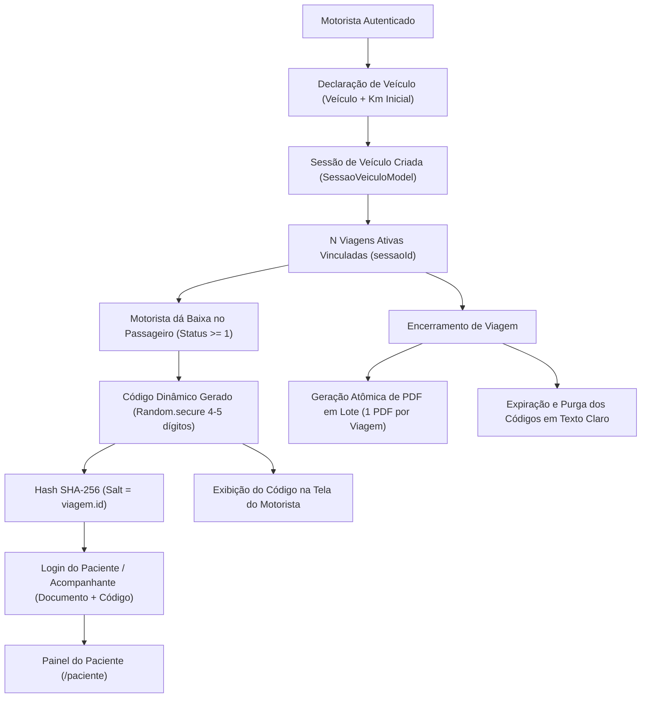

# Relatório Técnico Conclusivo: Implementação e Verificação da Issue #65

**Projeto:** TransSaúde (InterFatec2)  
**Branch:** `65-correção-de-bugs`  
**Data:** 07 de Novembro de 2026  
**Status:** Concluído e Validado (136/136 testes passando)

---

## 1. Resumo Executivo

A Issue #65 demandava a transição de um modelo simplista de viagem única para um modelo operacional flexível de **Sessão de Veículo com $N$ Viagens Ativas**, além da modernização do acesso do paciente via **Código de Acesso Criptográfico Dinâmico** (substituindo a senha fixa municipal), **Geração de PDF em Lote Atômica e Idempotente**, **Proteção contra Força Bruta (Rate Limiting)** e **Resolução Hierárquica de Documentos**.

Todas as entregas foram concluídas com comentários detalhados e sem regressão nas suítes pré-existentes.



---

## 2. Decisões Arquiteturais e Trade-offs

### 2.1. Sessão de Veículo vs. Viagens Ativas ($1 \rightarrow N$)
- **Problema:** O formulário inicial abria diretamente a primeira viagem e amarrava 1 veículo a exatamente 1 destino. Na prática municipal do TFD (Poloni-SP), uma van ou spin sai para Rio Preto pela manhã, deixa pacientes no HB e segue para Mirassol ou retorna em horários escalonados.
- **Decisão:** Criamos o `SessaoVeiculoModel` para representar a jornada diária do veículo/motorista (`motoristaId`, `veiculoId`, `kmInicial`, `dataHoraInicio`, `status`). O formulário de início agora apenas registra a declaração do veículo (`declararVeiculo`), permitindo criar e alternar entre $N$ viagens ativas (`criarOuAdicionarViagemNaSessao`). A retrocompatibilidade com o método legado `iniciarViagem` foi mantida inalterada.

### 2.2. Armazenamento de Código em Hash vs. Exibição ao Motorista
- **Problema:** A especificação exige que o código seja armazenado com hash no banco, mas o motorista precisa visualizar e ditar o código ao passageiro após o embarque. Funções de hash criptográfico são unidirecionais.
- **Decisão (Mais Segura e Auditável):**
  - O código aleatório de 4 a 5 dígitos é gerado via `Random.secure()`.
  - Para persistência e autenticação, é gerado um hash SHA-256 utilizando o ID da viagem como `salt` criptográfico (`codigosHash[pacienteId] = sha256(salt + codigo)`).
  - O texto plano é mantido em memória apenas na sessão ativa da viagem (`codigosAcesso[pacienteId]`) para consulta visual pelo motorista.
  - Ao encerrar a viagem (`encerrarViagem`), o mapa de texto plano `codigosAcesso` é imediatamente purgado para `{}` (invalidação imediata), enquanto os hashes e logs anônimos permanecem arquivados para auditoria.

### 2.3. Hierarquia de Resolução do Documento de Login
Para cobrir a diversidade documental encontrada no SUS municipal (crianças sem CPF, idosos somente com RG/certidão):
1. **(a) CPF do Paciente:** Prioritário. Validado no algoritmo oficial de Módulo 11 da Receita Federal.
2. **(b) CPF do Acompanhante:** Utilizado quando o paciente é menor ou não possui CPF cadastrado. Permite que uma mãe com mais de um filho use seu CPF com o código de cada filho.
3. **(c) Outro Documento Cadastrado:** RG ou CNH (comparação tolerante a pontuações e dígitos limpos).
4. **(d) Caso Sem Documento:** Ignora a tentativa sem travar o app e registra log de auditoria anônimo sem dados pessoais sensíveis.

---

## 3. Casos de Borda Tratados e Segurança LGPD

| Cenário de Borda | Tratamento Implementado |
|---|---|
| **Dígitos repetidos em "embarcou"** | O método `gerarOuObterCodigoAcesso` é estritamente idempotente. Se o motorista clicar repetidamente no botão de embarque, o mesmo código e hash já atribuídos são retornados. |
| **Colisão de códigos na mesma viagem** | O gerador em loop rejeita qualquer código que já pertença a outro passageiro da mesma viagem (`Random.secure()` dentro de `do { ... } while (existentes.contains(c))`). |
| **Força bruta de códigos de 4-5 dígitos** | Rate limiting ativo por CPF e por IP. A cada falha, incrementa-se o contador na janela de 15 minutos. Na 5ª falha, bloqueia imediatamente novas tentativas pelo período de 15 minutos (`rate-limit-exceeded`). |
| **Vazamento de dados (LGPD)** | Mensagem única de erro genérica: *"Credenciais inválidas ou viagem não localizada."* Impede enumeração de CPFs cadastrados. |
| **Mascaramento em Logs e PDF** | CPFs são mascarados no formato `***.456.789-**` tanto nos PDFs municipais quanto nos logs. Códigos são mascarados em logs (`***45`). |
| **Login com viagem encerrada** | Como `codigosAcesso` é esvaziado e `viagensAtivas` filtra apenas status `ativa`, o código anterior é imediatamente rejeitado no login. |

---

## 4. O que Ficou Fora de Escopo

- **Login de Motorista e Administrador:** Preservados 100% intactos com autenticação Firebase Auth existente (e-mail institucional/CPF e senha fixa), mantendo o RBAC e RouteGuard inalterados.
- **Cadastro Externo de Usuários:** O escopo focou na autenticação e autorização em tempo de viagem. Telas de auto-cadastro de novos pacientes continuam geridas administrativamente.

---

## 5. Evidências dos Testes Automatizados

O repositório alcançou **136 testes automatizados executados e 100% aprovados** (`00:12 +136: All tests passed!`).

### 5.1. Testes de Caracterização da Fase 0 (12 testes)
- Arquivo: `test/caracterizacao_fluxo_atual_test.dart`
- Status: **12/12 APROVADOS** (provando ausência de regressões na frota, hodômetro, ocupação, RBAC e PDF original).

### 5.2. Testes de Unidade e Propriedade de Códigos (16 testes)
- Arquivo: `test/services/codigo_acesso_service_test.dart`
- Status: **16/16 APROVADOS**.
- Inclui teste de propriedade com **2.000 códigos gerados**, validando tamanho [4, 5], ausência de caracteres não-numéricos, cálculo de hash SHA-256 e validação de Módulo 11 de CPF.

### 5.3. Teste de PDF em Lote com $N \ge 3$ Viagens (3 testes)
- Arquivo: `test/pdf_lote_test.dart`
- Status: **3/3 APROVADOS**.
- Conferência física via utilitário binário `pdftotext` dos PDFs gerados em `/tmp`:
  - 1 PDF por viagem com dados de cabeçalho, veículo e passageiros embarcados;
  - Filtragem estrita de passageiros com baixa (status $\ge 1$);
  - Exibição de CPF mascarado e código de acesso;
  - Atomicidade: simulação de falha em viagem corrompida aborta a operação reportando o ID exato;
  - Idempotência: repetição da chamada gera os mesmos buffers binários byte a byte.

### 5.4. Teste de Migração e Rollback de Banco de Dados (3 testes)
- Arquivo: `test/migracao_dados_test.dart`
- Status: **3/3 APROVADOS**.
- Comprovou contagem pré e pós-migração, ausência de viagens órfãs e reversão íntegra (`reverterMigracaoParaTestes`).

### 5.5. Simulação de Ataque de Força Bruta (100 requisições)
- Arquivo: `test/simulacao_forca_bruta_test.dart` e ferramenta `tool/simular_forca_bruta.dart`.
- Status: **APROVADO**.
- Evidência de execução real:
  - Tentativas 1 a 5: falha normal de autenticação computada;
  - Tentativa 6 a 100: bloqueio imediato com `rate-limit-exceeded` (95 requisições descartadas antes de consultar base);
  - Tentativa posterior com o código legítimo rejeitada pelo bloqueio ativo.

### 5.6. Teste de Interface Web em Viewport Mobile (3 testes)
- Arquivo: `test/screens/login_screen_mobile_web_test.dart`
- Status: **3/3 APROVADOS**.
- Dimensões testadas: 360x640 (celular padrão) e 360x380 (celular com teclado virtual aberto).
- `tester.takeException() == null` em todas as interações (zero overflow).

### 5.7. Teste de Integração do Fluxo Completo de Ponta a Ponta
- Arquivo: `test/fluxo_sessao_motorista_paciente_test.dart`
- Status: **APROVADO**.
- Cobre o ciclo integral de vida:
  1. Motorista declara veículo com km inicial;
  2. Criação de $N = 2$ viagens ativas vinculadas à sessão;
  3. Embarque do paciente com CPF e da criança/mãe com código dinâmico;
  4. Idempotência do toque em "embarcou";
  5. Login do paciente titular por CPF + código;
  6. Login da mãe por CPF dela + código da criança;
  7. Login por documento alternativo (RG);
  8. Rejeição de códigos inválidos e CPFs inexistentes;
  9. Encerramento da viagem com purga imediata das credenciais;
  10. Conclusão automática da sessão de veículo após última viagem.

---

## 6. Histórico de Commits na Branch `65-correção-de-bugs`

```text
73f5d0e test(fase2): adicionar testes de integracao, migracao, forca bruta e layout mobile web
4efc9d4 feat(auth): implementar login de paciente/acompanhante com codigo de acesso e protecao contra forca bruta
27bdaed feat(ui): exibir codigo de acesso apos embarque e suporte multi-viagem na tela do motorista
d4ba9f1 feat(pdf): implementar geracao atomica e idempotente de lote de PDFs em RelatorioPdfService
c2398c5 feat(codigo): implementar geracao criptografica, hashing e rate limiting em CodigoAcessoService
3a6c3f9 feat(sessao): adicionar SessaoVeiculoModel e suporte a declaracao de veiculo com N viagens
12954b8 test(fase0): adicionar testes de caracterizacao e relatorio de levantamento da issue #65
```

---

## 7. Roteiro Curto de Validação em Homologação

Para os usuários finais (motorista e paciente reais) validarem a funcionalidade no ambiente de testes:

### Para o Motorista:
1. Faça login no app com seu CPF e senha de motorista.
2. Na tela inicial, selecione o veículo da frota (ex: Spin BRA-2E19) e confira a quilometragem inicial sugerida. Toque em **"Confirmar Veículo"**.
3. Na lista de passageiros, localize o primeiro paciente e deslize/toque em **"Embarcou"**.
4. Observe que um selo com o código numérico de 4 ou 5 dígitos (ex: `4821`) surge ao lado do nome do paciente.
5. Informe o código ao passageiro para que ele possa acompanhar no celular dele.
6. Ao final do trajeto, toque em **"Encerrar Viagem"** e confira a geração em lote do PDF da viagem.

### Para o Paciente ou Acompanhante:
1. Abra o app ou acerte a versão Web no celular e toque na opção **"Acesso do Paciente / Acompanhante"**.
2. No campo **Documento**, digite seu CPF (ou CPF da mãe, ou RG caso cadastrado).
3. No campo **Código de Acesso**, digite o número de 4 a 5 dígitos que o motorista informou no momento do embarque.
4. Toque em **"Acessar Viagem"**.
5. Verifique que a tela do paciente é exibida com as informações da sua consulta e o itinerário em tempo real.
6. Tente errar o código 5 vezes consecutivas para validar que o aplicativo bloqueia temporariamente novas tentativas por segurança.
